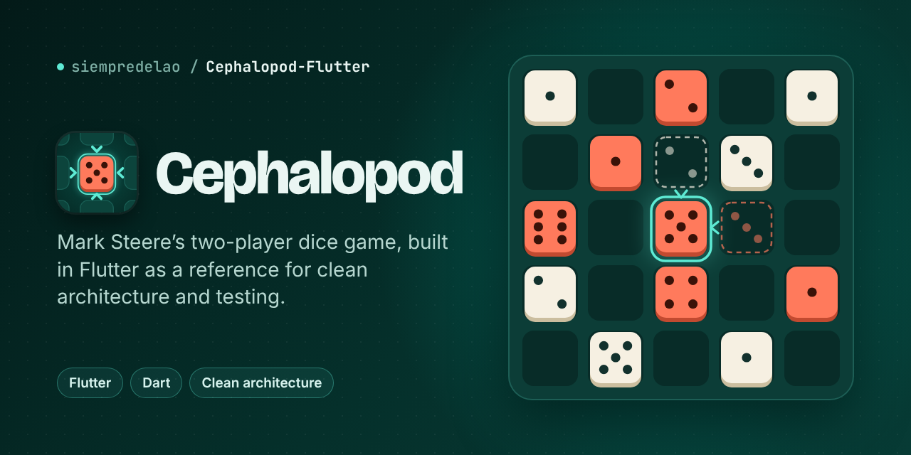

[](https://github.com/siempredelao/Cephalopod-Flutter/actions/workflows/ci.yaml)

A Flutter implementation of **Cephalopod**, the two-player dice game invented by
[Mark Steere](https://www.marksteeregames.com) in 2006. The project doubles as a
reference for clean architecture, SOLID and testing in Flutter: the rules live in
a pure-Dart package, the app sits on top, and CI enforces the boundaries.

**Status:** M5, polish. Play a friend on one device or the computer at three
levels (Easy, Medium, Hard), undo and redo moves, leave and continue later,
in English or Spanish, with a system, light or dark theme. Dice animate as
they are placed and captured, screen readers announce each move, and the
About page links the rule sheet. Underneath is a rules engine tested with
1,000 seeded random games checked move by move, and golden images lock in
how the main screens look. Next is M6: UX, then M7: Google Play.

## The game

Two players take turns placing dice of their colour on a 5×5 board.

- A die placed next to two or more dice whose pips add up to 6 or less
  **captures** them: they leave the board and the new die shows their sum.
- Any other placement shows a 1.
- When all 25 squares are full, the player with more dice wins. There are no
  draws.

Full rules: [official rule sheet](https://www.marksteeregames.com/Cephalopod_rules.pdf).
Cephalopod is © Mark Steere, who allows anyone to program the game provided its
name and rules stay unchanged and he is credited. This app does both.

## Architecture

```text
  presentation ──────────▶ domain ◀────────── data
  views, blocs        use cases,         repositories,
       │              repo interfaces    services
       │                   │                  │
       └───────────────────┼──────────────────┘
                           ▼
     cephalopod_engine: pure Dart, no Flutter, no I/O
```

- **`packages/cephalopod_engine`** holds the rules. It has no Flutter
  dependency, so the compiler keeps UI code out, and every rule is tested
  without a device.
- **`app`** follows Flutter's recommended MVVM split (views, view models,
  repositories, services) with a small domain layer, organised by feature.
- **`tool/check_architecture.dart`** fails CI when an import breaks the
  dependency rule.

Details: [docs/architecture.md](docs/architecture.md). Decisions and their
trade-offs: [docs/adr](docs/adr/README.md).

## Repository layout

```text
.
├── app/                         Flutter app (package: cephalopod)
│   ├── lib/
│   │   ├── app/                 App widget, router, theme, composition root
│   │   ├── core/                Code shared by features
│   │   └── features/<name>/     domain/ · data/ · presentation/
│   └── test/                    Mirrors lib/
├── packages/cephalopod_engine/  Rules engine, pure Dart
├── tool/                        Architecture and coverage checks
├── docs/                        Architecture notes and ADRs
└── pubspec.yaml                 Pub workspace root and Melos scripts
```

## Getting started

Requirements: Flutter 3.47.9 (Dart 3.13.7).

```sh
flutter pub get                      # resolves the whole workspace
dart run melos run generate          # freezed code, which is not committed
dart run melos run verify            # everything CI checks
cd app && flutter run -t lib/main_dev.dart
```

UI states are [freezed](https://pub.dev/packages/freezed) classes. Run
`generate` again after changing one, or keep `dart run melos run generate:watch`
running. Why the generated files stay out of git:
[ADR 0011](docs/adr/0011-freezed-for-ui-states.md).

### One-time: generate the platform folders

The repository holds only Dart code until platform folders are committed.
Generate them once from `app/`:

```sh
cd app
flutter create --platforms=android,ios --org gc.david --project-name cephalopod .
rm -f test/widget_test.dart          # sample test from the template; not used here
```

`--org gc.david` plus the project name gives the application ID and bundle
identifier `gc.david.cephalopod`.

Commit the new `android/` and `ios/` folders and `.metadata`. CI then also runs
an Android smoke build. The web is not a target, so there is no `web/` folder.

## Quality gates

Every push and pull request runs, in order:

1. `dart format` check
2. Code generation (`build_runner`)
3. `flutter analyze --fatal-infos` with [very_good_analysis](https://pub.dev/packages/very_good_analysis)
4. Architecture check
5. Engine tests, 100% line coverage required
6. App tests, 85% line coverage required

At the same time, a separate job runs an Android APK smoke build, so the two
finish together instead of one after the other.

Run the same checks locally with `dart run melos run verify`. Optional git
hooks: install [lefthook](https://lefthook.dev) and run `lefthook install`.

### Golden images

Some screens are kept as images in `app/test/goldens/images/`, and the app
tests compare each screen with its image, pixel by pixel. A change to how one
of them looks fails the tests until the images are drawn again:

```sh
cd app && flutter test test/goldens --update-goldens
```

Look at the new images before committing them: the diff of the pull request
shows the old and the new side by side. When a golden test fails, Flutter
writes the expected image, the new one and their differences in
`app/test/goldens/failures/`; on CI they are kept as the `golden-failures`
download of the run.

The images are drawn on Linux, as CI is, with the Flutter version above and
its Roboto font. Another system or Flutter version can draw text a pixel
differently, and fail every golden.

## Releasing to Google Play

Play only accepts a release signed with your own upload key. Without one,
`flutter build appbundle` still works, but signs with the debug key, so CI and
a fresh clone build fine. Play rejects that bundle.

### Make the upload key (once)

Keep the key outside the repository, for example in `~/.keys/`:

```sh
mkdir -p ~/.keys
keytool -genkey -v -keystore ~/.keys/cephalopod-upload.jks \
  -keyalg RSA -keysize 2048 -validity 10000 -alias upload
```

Then create `app/android/keystore.properties`, which git ignores:

```properties
storeFile=/home/you/.keys/cephalopod-upload.jks
storePassword=the password you chose
keyAlias=upload
keyPassword=the password you chose
```

**Back up the `.jks` file and both passwords** in a password manager, and
somewhere else too. With Play App Signing, Google holds the key that signs
what people install, so a lost upload key can be reset by Google's support.
Still, it takes days, so keep the backup.

### Build the bundle

```sh
cd app
flutter build appbundle
```

The signed bundle is `build/app/outputs/bundle/release/app-release.aab`. The
version comes from `pubspec.yaml`: in `0.1.0+1`, `0.1.0` is what people see
and `1` is the build number. Play wants a higher build number for every
upload, so raise it each time.

## Roadmap

- [x] **M0 · Foundations**: workspace, lints, CI, ADRs, app shell
- [x] **M1 · Rules engine**: board, moves, captures, property tests
- [x] **M2 · Playable MVP**: hot-seat game on one device
- [x] **M3 · Persistence and undo**: resume, undo/redo, settings with a theme
  choice (system, light or dark)
- [x] **M4 · AI opponent**: three difficulty levels
- [x] **M5 · Polish**: accessibility, English and Spanish, placement and capture
  animations, light and dark board palettes, rule-sheet link and app version on
  About, goldens
- [x] **M6 · UX**: How to play on first launch, a simpler game app bar, a dice
  count, a hint, effects and sounds for captures and wins. (The first M6, a web
  release, was dropped with the web build.)
- [ ] **M6 follow-ups**: a new Home screen with a board that plays a capture,
  How to play as a feature of its own, and captured dice that burst one at
  a time with a pop each
- [ ] **M7 · Google Play**: twelve languages, an open-source licenses screen,
  launcher icons and splash screen, a rating prompt, release signing, store
  listing and screenshots

## Contributing

Conventional Commits, short-lived branches, squash merges into `main`. The pull
request template lists what a change needs before review.

## License

The code is under the [PolyForm Strict License 1.0.0](LICENSE): you may read
it and run it for noncommercial purposes, but not change it, share it or use
it commercially. The license covers only the code in this repository. The game,
Cephalopod, was invented by [Mark Steere](https://www.marksteeregames.com).
