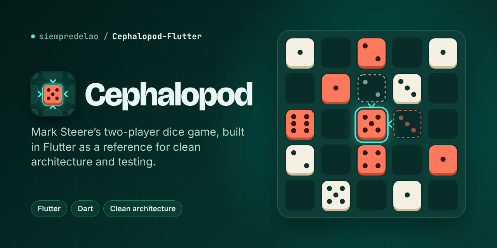
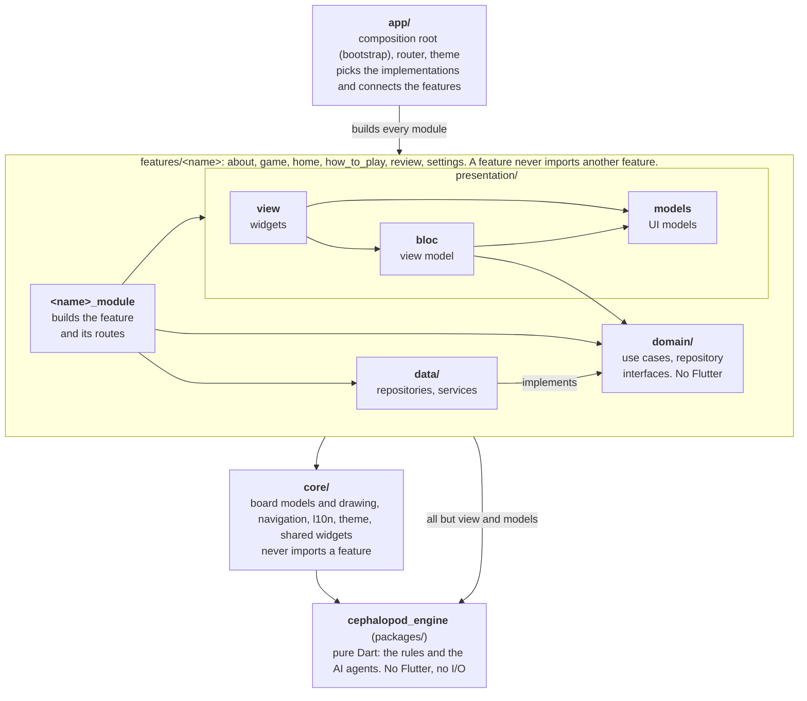

[](https://github.com/siempredelao/Cephalopod-Flutter/actions/workflows/ci.yaml)

[](https://play.google.com/store/apps/details?id=gc.david.cephalopod)

A Flutter implementation of **Cephalopod**, the two-player dice game invented by
[Mark Steere](https://www.marksteeregames.com) in 2006. The project doubles as a
reference for clean architecture, SOLID and testing in Flutter: the rules live in
a pure-Dart package, the app sits on top, and CI enforces the boundaries.

**Status:** M7, Google Play. The app is in internal testing on Google Play. You
can play a friend on one device or the computer at three levels (Easy, Medium,
Hard), undo and redo moves, get a hint, and leave and continue later from the
Home screen. It speaks twelve languages, has a system, light or dark theme,
sounds and capture effects, and screen readers announce each move. Underneath is
a rules engine tested with 1,000 seeded random games checked move by move, and
golden images lock in how the main screens look.

## The game

Two players take turns placing dice of their colour on a 5×5 board.

- A die placed next to two or more dice whose pips add up to 6 or less
  **captures** them: they leave the board and the new die shows their sum.
- Any other placement shows a 1.
- When all 25 squares are full, the player with more dice wins. There are no
  draws.

Full rules: [official rule sheet](https://www.marksteeregames.com/Cephalopod_rules.pdf).
Cephalopod is © Mark Steere, who allows anyone to program the game provided its
name and rules stay unchanged and he is credited. This app does both.

## Architecture

An arrow points from the code that imports to the code it imports. None points
back up: nothing imports `app/`, and the engine imports nothing of ours.



- **`packages/cephalopod_engine`** holds the rules. It has no Flutter
  dependency, so the compiler keeps UI code out, and every rule is tested
  without a device.
- **`app`** follows Flutter's recommended MVVM split (views, view models,
  repositories, services) with a small domain layer, organised by feature.
- **`tool/check_architecture.dart`** fails CI when an import breaks the
  dependency rule.

The full list of dependency rules, how CI enforces them and the testing levels:
[docs/architecture.md](docs/architecture.md). Decisions and their trade-offs:
[docs/adr](docs/adr/README.md).

## Repository layout

```text
.
├── app/                         Flutter app (package: cephalopod)
│   ├── lib/
│   │   ├── app/                 App widget, router, theme, composition root
│   │   ├── core/                Code shared by features
│   │   └── features/<name>/     domain/ · data/ · presentation/
│   ├── test/                    Mirrors lib/
│   ├── integration_test/        Tests that run on a device
│   └── android/, ios/           Platform projects
├── packages/cephalopod_engine/  Rules engine, pure Dart
├── tool/                        Checks, scripts for the sounds, the store
│                                screenshots and the Play uploads
├── art/                         App icon, store graphics and screenshots
├── fastlane/                    Texts of the Google Play listing
├── docs/                        Architecture notes, ADRs, privacy policy
└── pubspec.yaml                 Pub workspace root and Melos scripts
```

## Getting started

Requirements: Flutter 3.47.9 (Dart 3.13.7). The app targets Android and iOS; the
web is not a target, so there is no `web/` folder.

```sh
flutter pub get                      # resolves the whole workspace
dart run melos run generate          # freezed code, which is not committed
dart run melos run verify            # everything CI checks
cd app && flutter run -t lib/main_dev.dart
```

UI states are [freezed](https://pub.dev/packages/freezed) classes. Run
`generate` again after changing one, or keep `dart run melos run generate:watch`
running. Why the generated files stay out of git:
[ADR 0011](docs/adr/0011-freezed-for-ui-states.md).

## Quality gates

Every push and pull request runs, in order:

1. `dart format` check
2. Code generation (`build_runner`)
3. `flutter analyze --fatal-infos` with [very_good_analysis](https://pub.dev/packages/very_good_analysis)
4. Architecture check
5. Engine tests, 100% line coverage required
6. App tests, 85% line coverage required

At the same time, a separate job runs an Android APK smoke build, so the two
finish together instead of one after the other.

Run the same checks locally with `dart run melos run verify`. Optional git
hooks: install [lefthook](https://lefthook.dev) and run `lefthook install`.

### The on-device test

One test runs the real app on an Android emulator or phone, with its real
storage: it plays a move, closes the app, starts it again and continues the
game. CI does not run it, so run it before a release, with a device connected:

```sh
cd app && flutter test integration_test/play_save_resume_test.dart
```

The other test in `app/integration_test/` takes the Play Store screenshots. It
has its own script, `tool/take_store_screenshots.sh` (see
[art/README.md](art/README.md)).

### Golden images

Some screens are kept as images in `app/test/goldens/images/`, and the app
tests compare each screen with its image, pixel by pixel. A change to how one
of them looks fails the tests until the images are drawn again:

```sh
cd app && flutter test test/goldens --update-goldens
```

Look at the new images before committing them: the diff of the pull request
shows the old and the new side by side. When a golden test fails, Flutter
writes the expected image, the new one and their differences in
`app/test/goldens/failures/`; on CI they are kept as the `golden-failures`
download of the run.

The images are drawn on Linux, as CI is, with the Flutter version above and
its Roboto font. Another system or Flutter version can draw text a pixel
differently, and fail every golden.

## Roadmap

- [x] **M0 · Foundations**: workspace, lints, CI, ADRs, app shell
- [x] **M1 · Rules engine**: board, moves, captures, property tests
- [x] **M2 · Playable MVP**: hot-seat game on one device
- [x] **M3 · Persistence and undo**: resume, undo/redo, settings with a theme
  choice (system, light or dark)
- [x] **M4 · AI opponent**: three difficulty levels
- [x] **M5 · Polish**: accessibility, English and Spanish, placement and capture
  animations, light and dark board palettes, rule-sheet link and app version on
  About, goldens
- [x] **M6 · UX**: How to play on first launch, a simpler game app bar, a dice
  count, a hint, effects and sounds for captures and wins. (The first M6, a web
  release, was dropped with the web build.)
- [x] **M6 follow-ups**: a new Home screen with a board that plays a capture,
  How to play as a feature of its own, and captured dice that burst one at
  a time with a pop each
- [x] **M7 · Google Play**: twelve languages, an open-source licenses screen,
  launcher icons and splash screen, a rating prompt, release signing, store
  listing and screenshots, a privacy policy, and a first release in internal
  testing

## Releasing to Google Play

The upload key, the signed bundle, the steps of each release and the privacy
policy are in the [releasing guide](RELEASING.md).

## Contributing

Contributions are welcome. Please read the [contributing guide](CONTRIBUTING.md)
first.

## More documents

- [docs/privacy-policy.md](docs/privacy-policy.md): what the app does with your data.
- [fastlane/README.md](fastlane/README.md): the store listing and the upload scripts.
- [art/README.md](art/README.md): the icon, the store graphics and the screenshots.

## License

The code is under the [PolyForm Strict License 1.0.0](LICENSE): you may read
it and run it for noncommercial purposes, but not change it, share it or use
it commercially. The license covers only the code in this repository. The game,
Cephalopod, was invented by [Mark Steere](https://www.marksteeregames.com).
