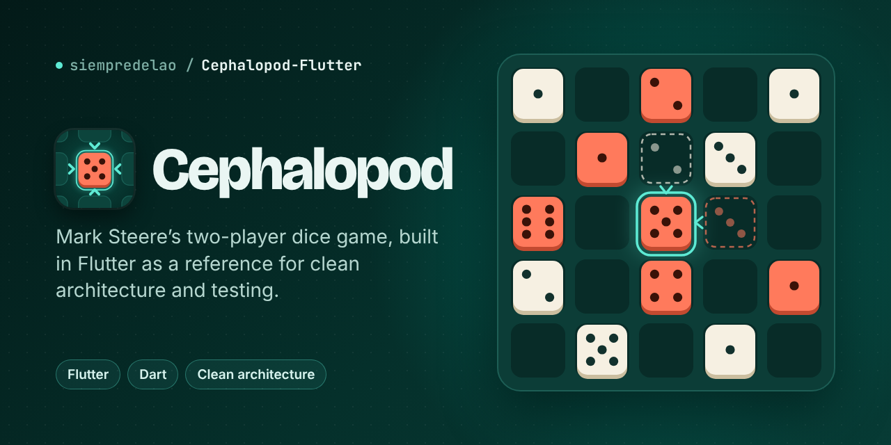

[](https://github.com/siempredelao/Cephalopod-Flutter/actions/workflows/ci.yaml)

A Flutter implementation of **Cephalopod**, the two-player dice game invented by
[Mark Steere](https://www.marksteeregames.com) in 2006. The project doubles as a
reference for clean architecture, SOLID and testing in Flutter: the rules live in
a pure-Dart package, the app sits on top, and CI enforces the boundaries.

**Status:** M3, persistence and undo. Two players can play a full game on one
device, undo and redo moves, leave and continue later, and choose a system,
light or dark theme, on top of a rules engine tested with 1,000 seeded random
games checked move by move. Next is M4: an AI opponent.

## The game

Two players take turns placing dice of their colour on a 5×5 board.

- A die placed next to two or more dice whose pips add up to 6 or less
  **captures** them: they leave the board and the new die shows their sum.
- Any other placement shows a 1.
- When all 25 squares are full, the player with more dice wins. There are no
  draws.

Full rules: [official rule sheet](https://www.marksteeregames.com/Cephalopod_rules.pdf).
Cephalopod is © Mark Steere, who allows anyone to program the game provided its
name and rules stay unchanged and he is credited. This app does both.

## Architecture

```text
  presentation ──────────▶ domain ◀────────── data
  views, blocs        use cases,         repositories,
       │              repo interfaces    services
       │                   │                  │
       └───────────────────┼──────────────────┘
                           ▼
     cephalopod_engine: pure Dart, no Flutter, no I/O
```

- **`packages/cephalopod_engine`** holds the rules. It has no Flutter
  dependency, so the compiler keeps UI code out, and every rule is tested
  without a device.
- **`app`** follows Flutter's recommended MVVM split (views, view models,
  repositories, services) with a small domain layer, organised by feature.
- **`tool/check_architecture.dart`** fails CI when an import breaks the
  dependency rule.

Details: [docs/architecture.md](docs/architecture.md). Decisions and their
trade-offs: [docs/adr](docs/adr/README.md).

## Repository layout

```text
.
├── app/                         Flutter app (package: cephalopod)
│   ├── lib/
│   │   ├── app/                 App widget, router, theme, composition root
│   │   ├── core/                Code shared by features
│   │   └── features/<name>/     domain/ · data/ · presentation/
│   └── test/                    Mirrors lib/
├── packages/cephalopod_engine/  Rules engine, pure Dart
├── tool/                        Architecture and coverage checks
├── docs/                        Architecture notes and ADRs
└── pubspec.yaml                 Pub workspace root and Melos scripts
```

## Getting started

Requirements: Flutter 3.47.1 (Dart 3.13.1).

```sh
flutter pub get                      # resolves the whole workspace
dart run melos run generate          # freezed code, which is not committed
dart run melos run verify            # everything CI checks
cd app && flutter run -t lib/main_dev.dart
```

UI states are [freezed](https://pub.dev/packages/freezed) classes. Run
`generate` again after changing one, or keep `dart run melos run generate:watch`
running. Why the generated files stay out of git:
[ADR 0011](docs/adr/0011-freezed-for-ui-states.md).

### One-time: generate the platform folders

The repository holds only Dart code until platform folders are committed.
Generate them once from `app/`:

```sh
cd app
flutter create --platforms=android,ios,web --org gc.david --project-name cephalopod .
rm -f test/widget_test.dart          # sample test from the template; not used here
```

`--org gc.david` plus the project name gives the application ID and bundle
identifier `gc.david.cephalopod`.

Commit the new `android/`, `ios/`, `web/` folders and `.metadata`. CI then also
runs Android and web smoke builds.

## Quality gates

Every push and pull request runs, in order:

1. `dart format` check
2. Code generation (`build_runner`)
3. `flutter analyze --fatal-infos` with [very_good_analysis](https://pub.dev/packages/very_good_analysis)
4. Architecture check
5. Engine tests, 100% line coverage required
6. App tests, 85% line coverage required
7. Android APK and web smoke builds

Run the same checks locally with `dart run melos run verify`. Optional git
hooks: install [lefthook](https://lefthook.dev) and run `lefthook install`.

## Roadmap

- [x] **M0 · Foundations**: workspace, lints, CI, ADRs, app shell
- [x] **M1 · Rules engine**: board, moves, captures, property tests
- [x] **M2 · Playable MVP**: hot-seat game on one device
- [x] **M3 · Persistence and undo**: resume, undo/redo, settings with a theme
  choice (system, light or dark)
- [ ] **M4 · AI opponent**: three difficulty levels
- [ ] **M5 · Polish**: accessibility, English and Spanish, placement and capture
  animations, light and dark board palettes, rule-sheet link and app version on
  About, goldens
- [ ] **M6 · Release v1.0**: launcher icons and splash screen, playable web
  build on GitHub Pages
- [ ] **M7 · Google Play**: crash reporting, release signing, store listing

## Contributing

Conventional Commits, short-lived branches, squash merges into `main`. The pull
request template lists what a change needs before review.
